<div align="center">



# 🏛️ Awesome Architecture-as-Code & Modeling Tools

### 🌐 The Definitive Ecosystem of Architecture-as-Code (AaC), C4 Modeling DSLs, Enterprise Architecture (EA) Platforms & Declarative Diagram Engines

<p align="center">
  <a href="https://github.com/ishandutta2007/Awesome-Awesome-Awesome"></a><a href="https://discord.gg/jc4xtF58Ve"></a>
  <a href="https://github.com/ishandutta2007/Awesome-Architecture-As-Code-Modeling-Tools/stargazers"></a>
  <a href="https://github.com/ishandutta2007/Awesome-Architecture-As-Code-Modeling-Tools/network/members"></a>
  <a href="https://github.com/ishandutta2007/Awesome-Architecture-As-Code-Modeling-Tools/blob/main/LICENSE"></a>
  <a href="https://github.com/ishandutta2007"></a>
</p>

**A curated index of production-ready SaaS platforms, declarative text-based DSLs, C4 model frameworks, and open-source system diagramming toolkits.**

*Track, version-control, validate, and automate software and enterprise architectures directly in Git CI/CD pipelines.*

**📅 Last updated: November 2026**

</div>

---

## 📖 Table of Contents

- [📌 Overview](#-overview)
- [📊 Sector Overview & Market Dynamics](#-sector-overview--market-dynamics)
- [☁️ SaaS & Hosted Platforms](#️-saas--hosted-platforms)
- [🔓 Open-Source GitHub Projects](#-open-source-github-projects)
- [🛠️ Architectural Implementation Blueprint](#️-architectural-implementation-blueprint)
- [🤝 How to Contribute](#-how-to-contribute)
- [💖 Support](#-support)
- [📈 Star History](#-star-history)
- [⚠️ Disclaimer](#️-disclaimer)

---

## 📌 Overview

Modern engineering organizations treat software architecture and system documentation like source code (**Architecture-as-Code** / **Diagrams-as-Code**). Rather than maintaining static, outdated drawing board diagrams, teams use declarative domain-specific languages (DSLs), automated visualizers, and Enterprise Architecture Management (EAM) repositories to:

- 🏗️ **Model systems at multiple zoom levels** using standardized abstractions like the [C4 Model](https://c4model.com) (Context, Containers, Components, Code).
- 🔄 **Ensure single-source-of-truth governance** synchronized directly with Git commits, pull requests, and continuous integration workflows.
- 📉 **Eliminate architectural drift** with automated dependency discovery, cloud topology mapping, and drift detection.
- 🎯 **Streamline stakeholder communication** across engineering, platform ops, security, and executive governance.

---

## 📊 Sector Overview & Market Dynamics

The global **Enterprise Architecture (EA) Software & System Modeling** market is estimated at **$1.35B – $3.5B+** (progressing at an ~8–11% CAGR through 2030), accelerated by enterprise cloud migrations, microservice complexity, and automated AI governance. The sector is **moderately fragmented**: enterprise portfolio management is led by consolidated corporate incumbents (SAP LeanIX, Bizzdesign-MEGA-Alfabet), while the rapid developer-centric **Architecture-as-Code (AaC)** and **Diagrams-as-Code** subsegment is a vibrant, decentralized open ecosystem fueled by agile startups and community-driven open-source DSL standards.

---

## ☁️ SaaS & Hosted Platforms

*Enterprise SaaS and collaborative hosted suites for interactive C4 modeling, cloud inventory synchronization, and enterprise portfolio management (sorted descending by corporate scale / valuation).*

| Platform | Corporate Scale / Valuation | Pricing (Starting Tier) | Free Tier Limits | Description |
| :--- | :--- | :--- | :--- | :--- |
| 🏢 **[SAP LeanIX](https://leanix.net)** | **~$1.2 Billion** (Acquired by SAP; ~$100M ARR scale) | Custom quote-based (starts around $30,000/year for application portfolio tiers) | 30-day free trial (access to Application Portfolio Management evaluation sandbox with sample models) | Enterprise Architecture Management (EAM) SaaS platform for mapping application portfolios, cloud transformations, technology risk, and automated dependency graphs. |
| 🏢 **[Bizzdesign Horizzon](https://bizzdesign.com)** | **~$300M+** (Main Capital backed; €110M+ combined group revenue with MEGA & Alfabet) | Custom quote-based (entry tiers start around €5,000/year; designer seats from ~£2,500/seat/year) | 14-day free trial (access to evaluation environment for business prospects upon approval) | Cloud enterprise architecture and business transformation suite supporting ArchiMate, BPMN, and portfolio modeling across large organizations. |
| 🦄 **[Ardoq](https://ardoq.com)** | **$300M+ Valuation** ($164M total funding raised; ~$35M+ ARR) | Custom quote-based (app-based portfolio tiers; starting around $60,000/year via marketplace packages) | 14-day guided proof-of-value trial (limited to prospective enterprise evaluation pilot with a subset of workspace data) | Data-driven cloud Enterprise Architecture platform turning structured repository data into automated, dynamic system visualizations and impact analysis maps. |
| 💼 **[Visual Paradigm Online / Cloud](https://visual-paradigm.com)** | **~$20M - $30M Est. Revenue** (Global established modeling vendor) | $4/user/month (billed annually) for Starter tier ($9/user/month for Advance) | Free forever plan: 1 GB cloud workspace storage, non-commercial use with basic diagramming shapes; 30-day trial for premium features | Cloud-enabled UML, ArchiMate, C4, and SysML modeling suite offering round-trip code engineering, database schema design, and team repository hosting. |
| 💼 **[Sparx Systems Enterprise Architect (Pro Cloud Server)](https://sparxsystems.com)** | **~$5M - $8M Est. Revenue** (Self-funded global CASE tool vendor) | $5,350/year for Pro Cloud Server Team Edition (up to 7 repositories, unlimited web viewers) | 30-day free trial (full functionality across all editions with watermark on exported diagrams and reports) | Comprehensive UML, SysML, and ArchiMate modeling platform with cloud-hosted WebEA repositories and real-time collaborative model governance. |
| 🚀 **[Draw.io Cloud (diagrams.net / JGraph)](https://diagrams.net)** | **~$3M - $5M+ ARR** (Bootstrapped profitable category leader) | Free standalone web app; Atlassian Cloud starts at $5/month (or free up to 10 users) | Free forever: 100% free with unlimited diagrams and storage via local/Google Drive/GitHub; Free on Confluence/Jira Cloud for up to 10 users | Cloud-integrated visual diagramming platform with native C4 shape libraries, Mermaid/PlantUML import, and direct GitHub/GitLab/Google Drive persistence. |
| 🌱 **[IcePanel](https://icepanel.io)** | **~$5M - $10M Est. Valuation** (Y Combinator backed; Seed stage; ~$450K ARR) | $40/editor/month (billed annually) for Growth tier | Free forever: 1 editor, unlimited viewers, up to 100 model objects, 2 tag groups, 1 flow per diagram | Collaborative C4 model architecture diagramming and modeling platform designed for interactive system zooming, versioned snapshots, and Reality-synced cloud inventories. |
| 🧑‍💻 **[Structurizr Cloud](https://structurizr.com)** | **Independent / Boutique** (Creator-owned by Simon Brown) | £300/month (billed annually) for 1–20 users (paid server edition) | Free forever (Cloud & Playground): 1 workspace with Structurizr Cloud free tier / open-source Structurizr Lite & local tools | Official hosted workspace platform for the Structurizr DSL and C4 model, providing interactive multi-view diagrams, architecture decision records (ADRs), and team collaboration. |
| 🧑‍💻 **[Software Ideas Modeler](https://softwareideas.net)** | **Independent / Boutique** (Privately held developer-led studio) | $59 lifelong license (Standard Edition for commercial use; $399 for Team Server) | Free forever Standard Edition for non-commercial personal use; 30-day free trial for commercial/all editions | Multi-standard diagramming and CASE modeling tool supporting UML, SysML, ArchiMate, BPMN, ERD, and automated source code generation. |
| 🌐 **[PlantUML Web Server / Cloud](https://plantuml.com)** | **Open-Core / Ad-Supported** (Open-source foundation project) | Free public cloud rendering API; Professional license available to suppress sponsored error banners | Free forever: public cloud API server with a 4096px image dimension limit | Hosted rendering service transforming plain-text PlantUML and C4-PlantUML definitions into shareable SVG, PNG, and ASCII architecture diagrams. |

---

## 🔓 Open-Source GitHub Projects

*Git-native Architecture-as-Code DSLs, C4 modeling runtimes, programmatic diagram generators, and developer portal engines (sorted descending by GitHub Stars_Count).*

- 🎨 **[Excalidraw](https://github.com/excalidraw/excalidraw)** [](https://github.com/excalidraw/excalidraw/stargazers)  
  Virtual whiteboard for sketching hand-drawn diagrams, system architectures, and wireframes with collaborative real-time editing, programmatic JSON scene generation, and Mermaid syntax import.

- 🧜‍♂️ **[Mermaid](https://github.com/mermaid-js/mermaid)** [](https://github.com/mermaid-js/mermaid/stargazers)  
  Ubiquitous JavaScript Markdown-inspired diagramming and charting tool natively supported in GitHub, GitLab, Notion, and Azure DevOps for C4 models, sequence diagrams, state machines, and system workflows.

- 🖥️ **[Draw.io Desktop](https://github.com/jgraph/drawio-desktop)** [](https://github.com/jgraph/drawio-desktop/stargazers)  
  Completely offline desktop diagramming application built with Electron for diagrams.net, supporting native C4 architecture shapes, UML/ERD libraries, and dark mode.

- 🐍 **[Mingrammer Diagrams (Diagram as Code)](https://github.com/mingrammer/diagrams)** [](https://github.com/mingrammer/diagrams/stargazers)  
  Prototyping cloud system architectures directly in Python code. Allows developers to script, visualize, and generate production-grade diagrams for AWS, GCP, Azure, Kubernetes, and On-Prem topologies.

- 🎸 **[Backstage (Spotify)](https://github.com/backstage/backstage)** [](https://github.com/backstage/backstage/stargazers)  
  Open platform for building developer portals featuring a centralized software catalog, interactive system relationship graphs, and Docs-like-Code (TechDocs).

- 📐 **[D2 (Declarative Diagramming)](https://github.com/d2lang/d2)** [](https://github.com/d2lang/d2/stargazers)  
  Modern declarative diagram scripting language written in Go that compiles readable text into clean, auto-laid-out architecture diagrams powered by ELK, Tala, and Dagre layout engines.

- 🗄️ **[Bytebase](https://github.com/bytebase/bytebase)** [](https://github.com/bytebase/bytebase/stargazers)  
  Database DevOps and schema change management workspace with automatic database architecture discovery and interactive ERD diagram generators.

- 🪴 **[PlantUML](https://github.com/plantuml/plantuml)** [](https://github.com/plantuml/plantuml/stargazers)  
  Battle-tested text-to-diagram open-source engine supporting UML, SysML, ArchiMate, and JSON/YAML visualization via plain text specifications.

- 🔄 **[bpmn-js](https://github.com/bpmn-io/bpmn-js)** [](https://github.com/bpmn-io/bpmn-js/stargazers)  
  BPMN 2.0 diagram rendering toolkit and web modeler written in JavaScript, widely used for enterprise business process modeling and workflow choreography.

- 🧩 **[C4-PlantUML](https://github.com/plantuml-stdlib/C4-PlantUML)** [](https://github.com/plantuml-stdlib/C4-PlantUML/stargazers)  
  Standardized PlantUML library combining the benefits of PlantUML and the C4 model for providing clear, hierarchical software architecture documentation.

- ⚡ **[LikeC4](https://github.com/likec4/likec4)** [](https://github.com/likec4/likec4/stargazers)  
  Modern Architecture-as-Code tool and declarative DSL with live React previews, VS Code extension, auto-layout computation, and interactive multi-view drilldown for C4 diagrams.

- 🕸️ **[Dagre](https://github.com/dagrejs/dagre)** [](https://github.com/dagrejs/dagre/stargazers)  
  Directed graph layout engine in JavaScript, acting as the foundational layout core for Mermaid, custom diagram web engines, and architecture graph renderers.

- 🔌 **[WireViz](https://github.com/wireviz/WireViz)** [](https://github.com/wireviz/WireViz/stargazers)  
  Easily document cables, wiring harnesses, and hardware system connection topology using plain text YAML syntax and Graphviz.

- 🌐 **[Kroki](https://github.com/yuzutech/kroki)** [](https://github.com/yuzutech/kroki/stargazers)  
  Unified HTTP API gateway and microservice that renders architecture diagrams from plain-text descriptions across 25+ formats (PlantUML, Mermaid, D2, Structurizr, Graphviz, BPMN, Excalidraw).

- 🗃️ **[SchemaCrawler](https://github.com/schemacrawler/SchemaCrawler)** [](https://github.com/schemacrawler/SchemaCrawler/stargazers)  
  Free, open-source database discovery and architecture comprehension tool that automatically crawls schema metadata to generate ERDs and lint database models.

- 📝 **[log4brains](https://github.com/thomvaill/log4brains)** [](https://github.com/thomvaill/log4brains/stargazers)  
  CLI and static site generator for documenting Architecture Decision Records (ADRs) directly inside your Git repository alongside code.

- 🏛️ **[Archi (coArchi)](https://github.com/archimatetool/archi)** [](https://github.com/archimatetool/archi/stargazers)  
  Leading cross-platform open-source ArchiMate modeling toolkit for enterprise architects, supporting Git-based team collaboration through the coArchi plugin.

- 📐 **[Gaphor](https://github.com/gaphor/gaphor)** [](https://github.com/gaphor/gaphor/stargazers)  
  Extensible open-source desktop UML, SysML, RAAML, and C4 modeling application written in Python and GTK4 with full model validation.

- ☕ **[Structurizr Java / Extensions](https://github.com/structurizr/java)** [](https://github.com/structurizr/java/stargazers)  
  Core Java library and programmatic modeling client for the Structurizr software architecture ecosystem and C4 model definitions.

- 🏗️ **[C4-Builder](https://github.com/adrianvlupu/C4-Builder)** [](https://github.com/adrianvlupu/C4-Builder/stargazers)  
  CLI tool for compiling C4-PlantUML diagrams and Markdown documentation into interactive, searchable HTML/PDF architecture documentation sites.

- ⌨️ **[Structurizr CLI](https://github.com/structurizr/cli)** [](https://github.com/structurizr/cli/stargazers)  
  Official command-line utility for parsing, validating, exporting, and pushing Structurizr DSL workspaces in local environments and CI/CD pipelines.

---

## 🛠️ Architectural Implementation Blueprint

To establish an automated, production-grade Architecture-as-Code ecosystem in your engineering team, consider the following pipeline:

```text
+--------------------------------------------------------------------------+
| 1. Authoring: Git Repository (Code & Architecture)                       |
|    - Structurizr DSL / LikeC4 (.c4, .dsl) / Mermaid in Markdown docs     |
+------------------------------------+-------------------------------------+
                                     |
                                     v
+--------------------------------------------------------------------------+
| 2. CI/CD Validation & Build Pipeline (GitHub Actions / GitLab CI)        |
|    - Lint DSL syntax (Structurizr CLI / LikeC4 CLI)                      |
|    - Verify Architecture Decision Records (log4brains)                   |
|    - Render multi-view SVG/PNG diagrams via Kroki container gateway      |
+------------------------------------+-------------------------------------+
                                     |
                                     v
+--------------------------------------------------------------------------+
| 3. Living Documentation Portal & Catalog                                 |
|    - Spotify Backstage TechDocs / GitHub Pages / Static Site             |
|    - Interactive Zoomable Drilldown (Context -> Container -> Component)   |
+--------------------------------------------------------------------------+
```

---

## 🤝 How to Contribute

Contributions are welcome! Help us expand this ecosystem by adding tools or updating details:

1. 🍴 **Fork the repository**.
2. 🌿 **Create a feature branch**: `git checkout -b feature/add-new-tool`.
3. 📝 **Add your entry**: Ensure you follow the table or list schema (including links, descriptions, pricing/limits for SaaS, or Stars_Badges for open-source repos).
4. ✅ **Ensure accuracy**: Verify links, pricing tiers, and open-source star metrics.
5. 🚀 **Submit a Pull Request** with a concise description of why the tool belongs in this list.

---

## 💖 Support

If you find this curated ecosystem helpful for your architecture work or engineering team:

- ⭐ **Star this repository** to keep up with new tools and ecosystem updates.
- 🍴 **Fork and share** it with fellow software architects, platform teams, and engineering leaders.
- ☕ **Sponsor or buy a coffee**: Support ongoing open-source curation and tool development via the **[GitHub Sponsors Dashboard](https://github.com/sponsors/ishandutta2007)**!

---

## 📈 Star History

[](https://www.star-history.com/#ishandutta2007/Awesome-Architecture-As-Code-Modeling-Tools&type=date&legend=top-left)

---

## ⚠️ Disclaimer

- This is a community-curated directory intended strictly for educational and architectural research purposes.
- Storing architecture specifications in public Git repositories requires caution: never commit internal VPC networks, private IP addressing schemes, production passwords, or sensitive infrastructure credentials.
- When running self-hosted rendering engines (e.g., `PlantUML` or `Kroki`), enforce strict sandboxing, disable dangerous external entity includes, and restrict local network egress.

---

<div align="center">

**Built with ❤️ for Software Architects, Platform Engineers, Systems Modelers, and Open-Source Builders.**

</div>
